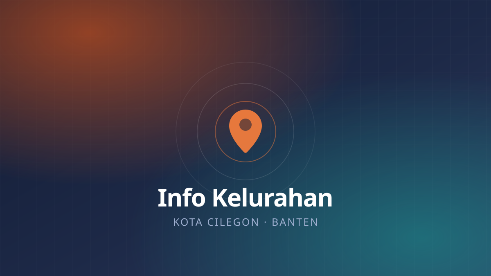

# Info Kelurahan — Portal Berita Kota Cilegon

Portal berita dan informasi kelurahan Kota Cilegon: **frontend + backend lengkap**,
modern, responsif di HP/tablet/desktop, dengan animasi yang halus dan tetap
ringan. Dibangun **sepenuhnya dengan perkakas gratis & open source**.



---

## ✨ Fitur

### Untuk pembaca
- **Beranda bergaya portal berita** — hero *slideshow* otomatis dengan parallax,
  statistik bergulir, kartu rubrik, direktori wilayah, agenda, dan pengumuman.
- **7 rubrik**: Pemerintahan, Pembangunan, Pendidikan, Kesehatan, Olahraga,
  Ekonomi, Sosial.
- **Peta wilayah** — 8 kecamatan & **43 kelurahan** lengkap (halaman profil per
  kelurahan: kontak, layanan, berita terkait).
- **Halaman artikel** — mode baca (perbesar/perkecil teks), penghitung pembaca,
  bagikan WhatsApp/salin tautan, berita terkait, dan atribusi sumber.
- **Pencarian instan** (`⌘K` / `Ctrl+K`) dan halaman hasil pencarian.
- **Agenda & pengumuman** kelurahan.
- Animasi *scroll reveal*, transisi halaman, dan mikrointeraksi — otomatis
  dimatikan bila pengguna memilih `prefers-reduced-motion`.

### Untuk redaksi
- **Dashboard admin** (`/admin`) untuk menulis, mengubah, dan menghapus berita.
- **Pratinjau langsung** saat menulis, editor paragraf dengan penebalan teks.
- Pilihan rubrik, kecamatan, kelurahan, penulis, serta headline.
- **Unggah foto sampul berupa berkas gambar** (klik atau lepas berkas) — bukan
  tempel URL. Format JPG/PNG/WEBP/AVIF/GIF, maksimal 5 MB, divalidasi tipe &
  isi berkasnya di server.
- Simpan sebagai **draf** atau langsung **terbitkan**.
- Status koneksi data (Supabase / mode demo) tampil di dashboard.

### Teknis
- SEO: metadata per halaman, **JSON-LD NewsArticle**, `sitemap.xml`,
  `robots.txt`, **RSS** (`/rss.xml`), dan **OG image** dinamis.
- Tema warna & tipografi terpusat (design token), aksesibilitas fokus keyboard.
- Fallback gambar otomatis bila foto sumber gagal dimuat.

---

## 🧱 Teknologi

| Lapisan | Pilihan | Lisensi / Biaya |
| --- | --- | --- |
| Framework | [Next.js 16](https://nextjs.org) (App Router, Turbopack) | MIT — gratis |
| UI | React 19 + TypeScript | MIT — gratis |
| Styling | [Tailwind CSS 4](https://tailwindcss.com) | MIT — gratis |
| Animasi | [Framer Motion](https://motion.dev) | MIT — gratis |
| Ikon | [Lucide](https://lucide.dev) | ISC — gratis |
| Font | Plus Jakarta Sans (self-hosted via Fontsource) | OFL — gratis |
| Database | [Supabase](https://supabase.com) (Postgres + REST) | Free tier |
| Hosting | [Vercel](https://vercel.com) | Hobby tier — gratis |

Tanpa layanan berbayar, tanpa SDK proprietary, tanpa lock-in.

---

## 🚀 Menjalankan lokal

```bash
npm install
npm run dev          # http://localhost:3000
```

Tanpa konfigurasi tambahan, aplikasi berjalan dalam **mode demo** memakai data
bawaan (16 berita, 43 kelurahan, agenda, dan pengumuman). Cocok untuk pratinjau
dan pengembangan.

```bash
npm run build        # build produksi
npm start            # jalankan hasil build
npm run typecheck    # cek tipe TypeScript
```

---

## 🔌 Menghubungkan Supabase (penyimpanan permanen)

1. Buat project gratis di [supabase.com](https://supabase.com).
2. Buka **SQL Editor**, tempel isi `supabase/schema.sql`, lalu **Run**.
   Skrip ini membuat tabel `posts`, `categories`, `announcements`, `agendas`,
   indeks, trigger `updated_at`, serta kebijakan RLS.
3. Ambil **Project URL** dan **service_role key** (Settings → API).
4. Salin `.env.example` menjadi `.env.local` dan isi:

```env
SUPABASE_URL=https://xxxx.supabase.co
SUPABASE_SERVICE_ROLE_KEY=eyJhbGciOi...
NEXT_PUBLIC_SITE_URL=https://infokelurahan.vercel.app
ADMIN_PASSWORD=ganti-dengan-sandi-anda
ADMIN_SESSION_SECRET=string-acak-panjang-minimal-32-karakter
AUTO_SEED=true
```

5. Jalankan ulang server. Saat tabel masih kosong, aplikasi otomatis mengisi
   data awal (`AUTO_SEED=true`).

> **Catatan arsitektur.** Aplikasi mengakses Supabase lewat **REST API**
> (`fetch` biasa) menggunakan `service_role` key yang hanya ada di server —
> tidak pernah dikirim ke peramban. Bila Supabase tidak dapat dijangkau atau
> skema belum siap, aplikasi **otomatis beralih ke mode demo** sehingga situs
> tidak pernah tampil kosong. Cek status via `GET /api/health`.

---

## 🌐 Deploy ke Vercel

1. Hubungkan repo ke Vercel, framework terdeteksi sebagai **Next.js**.
2. Tambahkan environment variable yang sama seperti `.env.local`
   (untuk produksi: `AUTO_SEED=false` bila database sudah terisi).
3. Deploy. File `vercel.json` sudah menyertakan region Singapura dan header
   cache untuk aset gambar.

---

## 🗂️ Struktur proyek

```
src/
├── app/
│   ├── page.tsx                  Beranda
│   ├── berita/                   Indeks & detail artikel
│   ├── kategori/                 Rubrik & per-rubrik
│   ├── wilayah/                  Kecamatan, kelurahan, direktori
│   ├── cari/                     Hasil pencarian
│   ├── agenda/                   Agenda & pengumuman
│   ├── tentang/ · kontak/        Halaman statis
│   ├── admin/                    Dashboard redaksi (login + panel)
│   ├── api/                      posts · search · agenda · views · admin · auth · health
│   ├── rss.xml/                  Feed RSS 2.0
│   ├── sitemap.ts · robots.ts    SEO
│   └── opengraph-image.tsx       OG image dinamis
├── components/
│   ├── motion/                   Reveal, ParallaxImage, CountUp, TiltCard, TextReveal…
│   ├── layout/                   Header, Footer, SearchDialog, PageHero, Newsletter
│   ├── news/                     HeroSlider, NewsCard, ArticleTools, PostExplorer
│   ├── home/ · wilayah/ · admin/ Komponen per-area
│   └── ui/                       SectionHeader, Chip
└── lib/
    ├── data/                     Repository: Supabase & driver demo
    ├── seed/posts.ts             Data awal (berita, agenda, pengumuman)
    ├── categories.ts             Master rubrik
    ├── wilayah.ts                8 kecamatan & 43 kelurahan
    ├── auth.ts                   Sesi admin HMAC-SHA256
    └── types.ts · utils.ts
supabase/schema.sql               Skema database + RLS
```

---

## 🖼️ Penyimpanan gambar unggahan

Unggahan foto sampul memakai strategi berlapis, dipilih otomatis:

| Prioritas | Penyimpanan | Syarat | Hasil URL |
| --- | --- | --- | --- |
| 1 | **Vercel Blob** | env `BLOB_READ_WRITE_TOKEN` | `https://….public.blob.vercel-storage.com/berita/…` |
| 2 | **Folder lokal** | selalu tersedia saat pengembangan | `/api/media/…` |
| 3 | **Supabase Storage** | bucket publik `media` sudah dibuat | `…/storage/v1/object/public/media/…` |

Aktifkan Vercel Blob (gratis, kuota Hobby) di dashboard Vercel: **Storage →
Create Database → Blob**, lalu hubungkan ke project. Token akan muncul sebagai
`BLOB_READ_WRITE_TOKEN` dan dipakai otomatis tanpa mengubah kode.

Bila memakai Supabase Storage, buat bucket publik bernama `media`:

```sql
insert into storage.buckets (id, name, public) values ('media','media',true)
on conflict (id) do nothing;
```

## 🔐 Keamanan

- Sesi admin: cookie `HttpOnly` bertanda-tangan **HMAC-SHA256**, berlaku 8 jam.
- Rate limit login: 6 percobaan / 10 menit per IP.
- `service_role` key hanya di sisi server; RLS aktif untuk akses publik.
- Header keamanan (`nosniff`, `Referrer-Policy`) via `next.config.ts`.
- Seluruh rute `/admin` & `/api/admin/*` dilindungi pemeriksaan sesi.

> Ganti `ADMIN_PASSWORD` dan `ADMIN_SESSION_SECRET` sebelum dipakai publik.
> Di produksi login **ditolak** bila `ADMIN_PASSWORD` tidak diisi.

---

## 📰 Sumber konten awal

8 berita pertama ditulis ulang dari rilis resmi
[berita.cilegon.go.id](https://berita.cilegon.go.id) (Diskominfo Kota Cilegon),
dengan **atribusi sumber dan tautan artikel asli** pada setiap halaman.
Foto memakai CDN sumber dan tetap menjadi hak milik pemilik aslinya.
8 berita pendukung bertema kelurahan ditandai sebagai **editorial contoh**
pada kolom editor. Data kontak kelurahan pada direktori juga bersifat contoh
sampai diperbarui melalui dashboard.

---

## 📄 Lisensi

Kode aplikasi: MIT.
Konten berita & foto: hak masing-masing pemilik sebagaimana disebutkan pada
halaman berita.
